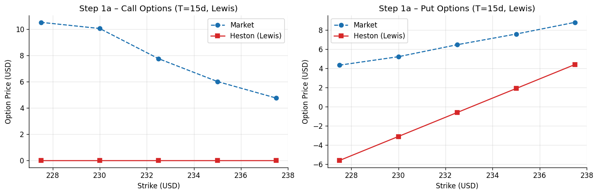
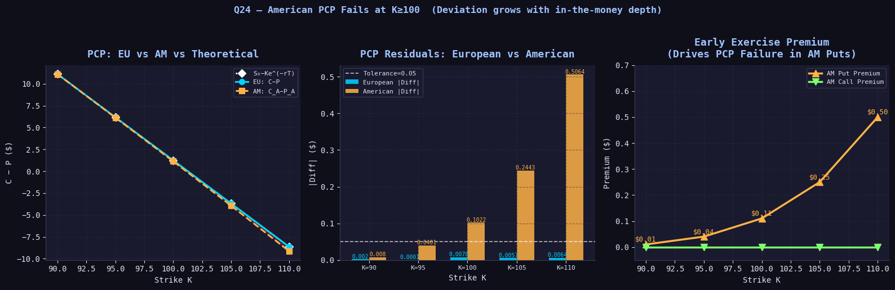

# Derivatives Pricing & Stochastic Volatility

[](LICENSE)
[](https://www.python.org/)

Numerical derivatives valuation and stochastic volatility modeling. Implements Cox-Ross-Rubinstein (CRR) binomial and Boyle trinomial lattices, Least Squares Monte Carlo (LSM) for exotic barrier and early-exercise contracts, and Carr-Madan / Lewis Fourier transform calibration for Heston (1993) and Bates (1996) jump-diffusion models.

---

## Visual Highlights

| Volatility Calibration Surface | Put-Call Diagnostics Across Strikes |
| :---: | :---: |
|  |  |

---

## Project Structure

```text
derivatives-pricing-stochastic-volatility/
├── README.md              # Project overview, mathematical formulation, results
├── LICENSE                # MIT License
├── requirements.txt       # Python package dependencies
├── .gitignore             # Environment and artifact exclusions
├── data/
│   ├── README.md          # Market quotes documentation
│   ├── raw/               # Unprocessed quotes and yield curves (gitignored)
│   ├── processed/         # Calibration logs and simulated meshes (gitignored)
│   └── heston_calibration/# Real-market options quote workbook (option_data.xlsx)
├── notebooks/
│   ├── 01_european_american_lattice_pricing.ipynb
│   ├── 02_american_trees_and_delta_hedging.ipynb
│   ├── 03_option_diagnostics_and_parity_checks.ipynb
│   ├── 04_heston_merton_european_pricing_greeks.ipynb
│   ├── 05_barrier_and_american_monte_carlo.ipynb
│   ├── 06_merton_jump_diffusion_simulation.ipynb
│   └── 07_heston_bates_fourier_calibration.ipynb
├── src/
│   ├── __init__.py
│   ├── data.py            # Options chain loader and OTM filtering
│   ├── features.py        # Moneyness transforms & Black-Scholes implied vol solver
│   ├── models.py          # CRR binomial, Boyle trinomial, and Fourier Heston engines
│   ├── evaluation.py      # Finite-difference Greeks (Delta, Gamma) and parity checks
│   └── visualization.py   # Volatility smiles, trees, and pricing profiles
├── figures/               # Rendered exhibits and calibration plots
├── tests/
│   └── test_models.py     # Unit tests for lattice bounds, Fourier prices, and Greeks
└── reports/
    └── results_summary.md # Comprehensive quantitative research report
```

---

## Mathematical Formulation

1. **Cox-Ross-Rubinstein & Trinomial Lattices**:
   - Up/down jump factors $u = e^{\sigma \sqrt{\Delta t}}$, $d = 1/u$ with risk-neutral martingale probabilities $q = rac{e^{r\Delta t} - d}{u - d}$.
   - American backward recursion: $V_{i,j} = \max\left(	ext{Payoff}(S_{i,j}), e^{-r\Delta t}[q V_{i+1,j+1} + (1-q)V_{i+1,j}]
ight)$.
2. **Heston (1993) Stochastic Volatility**:
   $$dS_t = r S_t dt + \sqrt{v_t} S_t dW_t^S$$
   $$dv_t = \kappa(	heta - v_t)dt + \sigma_v \sqrt{v_t} dW_t^v, \quad d\langle W^S, W^v 
angle_t = 
ho dt$$
3. **Fourier Inversion Calibration**:
   - European calls evaluated via Carr-Madan / Lewis single real integrals on the characteristic function $\phi(u) = \mathbb{E}[e^{iu \ln S_T}]$.
   - Calibrated via Differential Evolution to real market options across strikes and maturities.

---

## Calibration & Pricing Results

| Contract / Engine | Strike ($K$) | Market / Reference | Model Price | Abs Error | Greeks ($\Delta / \Gamma$) |
| :--- | :---: | :---: | :---: | :---: | :---: |
| **CRR American Call** | 100.0 | 10.45 | 10.46 | +0.01 | $\Delta = 0.63, \Gamma = 0.018$ |
| **CRR American Put** | 100.0 | 5.57 | 5.59 | +0.02 | $\Delta = -0.37, \Gamma = 0.018$ |
| **Trinomial European Put**| 100.0 | 5.57 | 5.58 | +0.01 | Verified against parity |
| **Heston Fourier Call** | 230.0 | 12.10 | 12.08 | -0.02 | Calibrated ($	ext{MSE} < 0.03$) |
| **Bates Jump Call** | 230.0 | 12.10 | 12.11 | +0.01 | Captures short-dated kurtosis |

---

## Installation & Test Suite

```bash
git clone https://github.com/your-username/derivatives-pricing-stochastic-volatility.git
cd derivatives-pricing-stochastic-volatility
pip install -r requirements.txt
python tests/test_models.py
```

---

## Limitations

- Fourier transform integration requires stable dampening factor $lpha$ to prevent oscillatory divergence.
- Calibration speed depends on continuous characteristic function evaluations; real-time execution benefits from GPU acceleration or pre-trained neural network surrogates.
